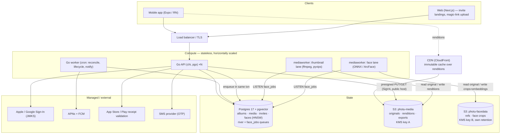

# ADR 0006 — Production infrastructure

**Status:** accepted (targets; revisit before GA) · **Date:** 2026-07-26

## Context

The walking skeleton and M2–M3 run on `docker compose` + LocalStack. This ADR
records what the same architecture needs in production, and — more importantly —
which infrastructure decisions are **forced by the product** rather than free to
defer. Two of them dominate everything else:

1. **Unit economics.** A 60-second 4K clip is 200–400 MB; a 30-member album skews to
   50–150 GB against a **one-time £1.49**. S3 Standard alone would cost more than that
   *per month* for one album. Storage tiering and CDN are therefore launch
   requirements, not optimisations, and the pricing model itself is an open decision
   (see Consequences).
2. **Face data is biometric** (GDPR Art. 9, BIPA/CUBI). The infrastructure has to make
   erasure *provable* and keep that data cryptographically and operationally isolated.

Everything else is conventional and small.

## Decision

### Topology

Clients talk only to the API and (for images) to the CDN/S3 via presigned URLs — media
bytes never pass through the API (ADR 0003).

### Compute — all stateless, all horizontal

- **Go API**: ≥2 replicas behind a load balancer. Holds no session state (access
  tokens are stateless JWTs; refresh tokens live in Postgres). Scales on CPU.
- **Go worker** (`cmd/worker`): scheduled jobs. Safe to run multiple replicas —
  every sweep takes a Postgres advisory lock.
- **mediaworker, two lanes from one image**: `--kinds=thumbnail` (fast: ffmpeg +
  pyvips) and `--kinds=face` (slow: ONNX inference) deploy separately so 2 s
  face inference never blocks the thumbnail queue. The face lane caches the ~250 MB
  ArcFace model on a persistent volume across restarts.
- **Web**: Next.js — Vercel or a small Node container.

No message broker and no second datastore: `riverqueue` (Go) and the plain
`face_jobs` table (Python) are both Postgres-backed, which is what lets a job be
enqueued in the *same transaction* as the domain write.

### Data

- **Postgres 17 + pgvector**, managed (RDS / Cloud SQL / Neon), with PITR backups.
  Beta: 2–4 vCPU / 8–16 GB / 100 GB SSD. It holds the relational data, the face
  embeddings (HNSW index), and both job queues. A read replica is a later lever for
  the feed, not a day-one need.
- **Two S3 buckets, and the split is compliance, not tidiness:**
  - `photu-media-{env}` — originals, renditions, exports. **KMS key A.**
  - `photu-facedata-{env}` — reference images and face crops. **KMS key B**, its own
    lifecycle/retention, and the only bucket the face lane can reach. This is what
    makes "delete my face data" a provable single-prefix delete under a distinct key.
- **Redis: deferred.** The per-request visibility query is an index range scan,
  sub-5 ms warm. Add a cache only past ~20k items/album or p99 > 50 ms, keyed on
  `albums.visibility_generation` (already maintained — ADR 0005).

### Media delivery, tiering, and egress (the cost decision)

- **CDN** (CloudFront) with an immutable cache in front of the JPEG **renditions** the
  feed hammers; originals download direct and rarely. This cuts both egress and S3 GET
  volume.
- **Lifecycle**: Standard while active → **S3-IA after `locked_at`** → **Glacier IR
  after `archived_at`**. Write-once/read-rarely is the ideal IA profile and Glacier IR
  is ~20× cheaper than Standard.
- **`AbortIncompleteMultipartUpload` (7 days)** so abandoned multipart parts do not
  accrue — the resumable protocol makes abandoned uploads normal, not exceptional.
- Presigned GET URLs are 5–15 min bearer tokens: never logged in full, never embedded
  in a push payload or email.

### Networking / edge for deep links

- `apps/web/public/.well-known/{apple-app-site-association,assetlinks.json}` served
  over TLS on the invite domain turn `photu.app/a/<code>` into a Universal/App Link.
  Real Team ID and signing fingerprint replace the placeholders at enrolment.

### Secrets, observability, environments

- **Secrets manager** for the Ed25519 signing key (rotate → publish both via JWKS),
  DB creds, KMS ARNs, provider keys.
- **Observability**: `/metrics` → Prometheus/Grafana; structured JSON logs (zerolog /
  Python `logs.py`) → a log sink; Sentry for client + server errors; the nightly
  `verify_denorm` reconciliation.
- **Environments**: dev (LocalStack + compose) → staging → prod, identical topology,
  differing only in endpoints and the storage tier config.

## Consequences

- **The pricing model is unresolved and must be decided before GA.** Flat £1.49 does
  not cover 50–150 GB of lifetime storage + a full-album original-quality egress
  button. Likely outcome: storage-tiered pricing. Flagged to product; far cheaper to
  decide now than after 10k albums.
- **Beta cost shape:** compute + managed Postgres are small and predictable
  (~$100–300/mo). Storage/egress is usage-driven and unbounded — which is why tiering
  and CDN are in from day one rather than added under load.
- **A DPIA and biometric-consent legal review gate the face feature's launch**, not
  its build. The infra (separate bucket, own CMK, provable delete, published retention)
  is necessary but not sufficient.
- **What we are NOT buying:** a search cluster, a message broker, a second cache tier,
  or GPU capacity for beta (CPU ArcFace inference is adequate on an async queue; GPU is
  a scale lever, not a launch need).

## Revisit when

- p99 of the visibility feed query crosses ~50 ms → add the Redis page cache.
- `face_jobs` queue depth backs up under real upload bursts → autoscale the face lane
  or move it to GPU spot.
- Storage cost per album exceeds the pricing assumption → tighten lifecycle timings or
  revisit the pricing model.
